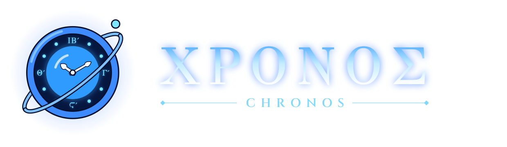

# Chronos

<p align="center"></p>

A quiet, monochrome calendar with a sticky-note board for every day and reminders for events and notes. Black and white, Apple's San Francisco typeface, plenty of space.

No build step and no dependencies. Open `index.html` in a browser, or serve the folder with any static host (GitHub Pages works). Everything is saved in your browser's `localStorage`.

## What you can do

**Calendar**
- A Today bar above the calendar with a live clock and what's up next
- A month calendar with animated transitions between months
- Drag event chips between days in Month view
- Repeating events (daily, weekdays, weekly, every 2 weeks, monthly, yearly), with an optional end date
- Moving or deleting one occurrence of a repeating event leaves the rest alone
- Calendars (Personal, Work, …) in post-it pastel colours that you can rename, recolour, hide or add to (in Settings)
- US holidays, computed for any year, each in its own colour (Christmas red, Halloween orange, St. Patrick's green…)
- Mark events as important (deadlines, tests…) with the star; they get their own Important section in the Today bar with a countdown
- Search across events and notes (`/`)

**Sticky notes**
- A post-it board for each day. Double-click anywhere on it to stick a note there. The post-its are the one colourful thing in an otherwise black-and-white app.
- Drag notes around by their top edge, or drop one onto any day in the calendar to move it there
- Eight paper colours and five handwriting fonts
- Turn a note into a checklist (with a progress bar and confetti when you finish)
- Mark notes done, duplicate them, or delete them with undo
- Notes show up as tiny post-its in the month view

**Reminders**
- Event reminders (at start, 5 min … 1 day before)
- Note reminders at any date and time, with quick presets
- In-app reminder cards with Snooze 10 min, plus an optional desktop notification and chime
- Reminders missed while the tab was closed show up when you come back (within 12 hours)

**Settings** (the sliders icon, or `,`)
- Five monochrome themes: Light (default), Paper, Auto (follows the system), Graphite and Dark
- Rain on glass, an animated theme: a night city seen through a rainy window. Drops bead up on the pane, grow, slide down in stop-start runs leaving trails, merge, and clear tracks through the fog; each drop refracts a flipped view of the street. Choose Drizzle, Rain or Storm (with lightning). Rendered with WebGL (simpler fallback without it); it pauses in background tabs and holds still with reduced motion.
- Accent (black by default), typeface (San Francisco, SF Rounded, New York, SF Mono; on non-Apple devices San Francisco falls back to Inter, its closest open match), corner roundness, density
- Event style (gray, solid, outline), 12/24-hour clock, week start, week numbers, hide weekends
- Export, import or copy a JSON backup

## Keyboard shortcuts

| Key | Action |
| --- | --- |
| `T` | Jump to today |
| `←` `→` | Previous / next |
| `C` | New event |
| `N` | New note |
| `/` | Search |
| `B` | Toggle day board |
| `,` | Settings |
| `R` | Reminders |
| `Ctrl` `Z` | Undo |
| `?` | All shortcuts |

Right-click a day, an event or a note for more options. On a phone, swipe left or right to change months.

## Logo

The mark is a glass hourglass of glowing blue sand in a glowing blue frame, on a transparent background. The full logo pairs it with CHRONOS and the Greek ΧΡΟΝΟΣ beneath. In the site header, hover the hourglass to flip it.

| File | Use |
| --- | --- |
| `assets/logo/chronos-logo.svg` | Horizontal logo for dark backgrounds |
| `assets/logo/chronos-logo-light.svg` | Horizontal logo for light backgrounds |
| `assets/logo/chronos-mark.svg` | The hourglass on its own |
| `assets/logo/chronos-mark-animated.svg` | The hourglass with falling sand |
| `assets/logo/chronos-mark-light.svg` | The hourglass for light backgrounds |
| `assets/logo/chronos-icon.svg` | Icon (plus 512, 192 and 180 px PNGs) |
| `assets/logo/chronos-favicon.svg` | Simplified icon for browser tabs (blue) |
| `assets/logo/chronos-favicon-mono.svg` | Monochrome tab icon used by the app |

The app itself uses a simple line-drawn hourglass in the header and `assets/logo/chronos-favicon-mono.svg` (black tile, white hourglass) as its tab icon, to match the monochrome interface.

The files above are generated by `tools/make_logo.py`. Lettering is converted to outlines, so no fonts are needed to display them. To regenerate, put `Cinzel-600.ttf` and `GFSDidot.ttf` from Google Fonts in a folder and run `python3 tools/make_logo.py path/to/folder` (needs `pip install fonttools`).

## Files

```
index.html       page structure and icons
css/styles.css   monochrome themes and layout
js/app.js        all app logic
assets/logo/     logo, icons and favicon
tools/           logo generator
```
